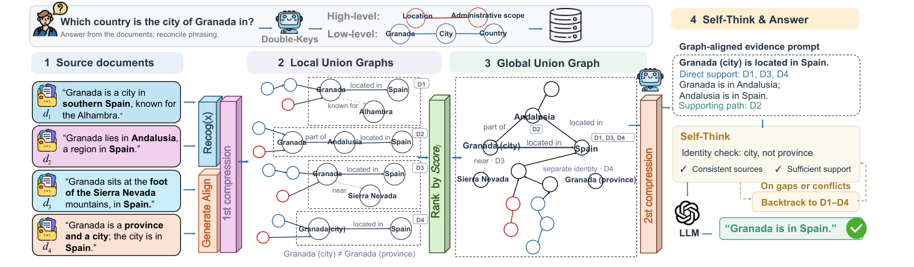
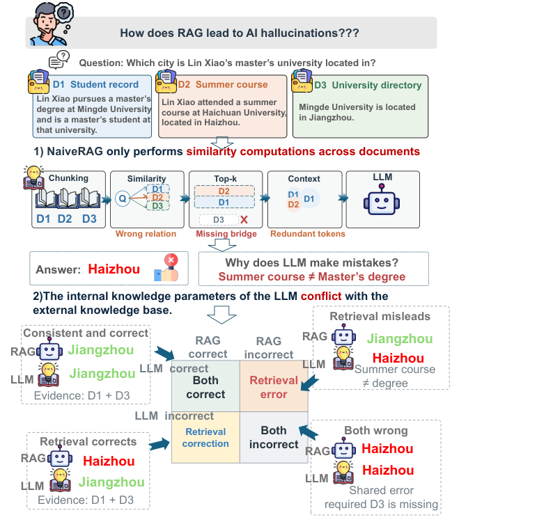

<h1 align="center">UGRAG: A Union Graph-Based Retrieval-Augmented Generation<br>Framework for Mitigating LLM Hallucinations</h1>

<p align="center"><strong>Official research implementation of UGRAG</strong></p>

<p align="center">
  
  
  
  
  
  <a href="https://github.com/ToChasePotential/UGRAG"></a>
</p>

UGRAG is a retrieval-augmented generation framework designed to mitigate unsupported answers in multi-document question answering. It explicitly links question requirements with entities, relations, and factual evidence distributed across documents. Instead of relying only on independently retrieved text chunks, UGRAG creates **source-grounded local union graphs**, integrates them into a **global union graph**, and uses **graph-guided compression** and **source-linked Self-Think verification** to support faithful, efficient answer generation.

## 🎉 News

- **2026-10** — UGRAG manuscript and its four-benchmark experimental protocol documented. The full public repository release and dependencies should be checked on GitHub.

## 📝 Abstract

Retrieval-augmented generation (RAG) still suffers from hallucinations when retrieved evidence conflicts with the parametric knowledge of large language models (LLMs) or fails to provide complete support across multiple documents. Existing RAG methods mainly rely on chunk-level similarity retrieval, ignoring the relationships among questions, documents, and evidence, which leads to unreliable answers and unnecessary context costs. We present Union Graph-Based Retrieval-Augmented Generation (UGRAG), which organizes fragmented document knowledge into a question-conditioned and source-grounded union graph. UGRAG connects entities, relations, and factual evidence across documents while preserving source provenance, enabling the model to construct complete evidence chains instead of relying on isolated passages. A graph-guided compression and source-linked verification mechanism further reduces redundant context while recovering supporting evidence when conflicts or insufficient evidence occur. Experiments on four multi-document QA benchmarks against eight advanced RAG approaches show improved answer accuracy, generation faithfulness, and inference efficiency.

## 🌟 Highlights

| Component | Role |
|---|---|
| **Double-Keys question representation** | Represents both explicit query entities and higher-level information requirements to guide evidence retrieval. |
| **Local union graphs** | Aligns question and document entities first, then relations, expanding source-grounded neighborhoods around matching anchors. |
| **Global union graph** | Merges equivalent cross-document entities and complementary relations while preserving document–chunk provenance. |
| **Two-round evidence compression** | Filters low-scoring documents and allocates limited context tokens according to graph-based evidence priorities. |
| **Self-Think verification** | Checks contradictions and evidence sufficiency, recovering original source chunks for revision when necessary. |

## 🧠 Framework

UGRAG connects **question-conditioned retrieval**, **cross-document union graph construction**, **two-stage compression**, and **source-grounded verification** in a single pipeline. Document graphs are constructed offline; graph alignment, evidence selection, verification, and answer generation are performed for each query.

<p align="center">
  
</p>

<sub>Framework reproduced from Figure 2 of the UGRAG manuscript.</sub>

### 🔎 Why multi-document RAG fails

Traditional chunk-level retrieval can confuse superficially similar relations, omit necessary bridge evidence, and use unnecessary context. A retrieved claim can also compete with the LLM's parametric knowledge. UGRAG treats **source-linked evidence organization** as a prerequisite for faithful generation.

<p align="center">
  
</p>

<sub>Motivating example adapted directly from Figure 1 of the UGRAG manuscript.</sub>

### 🔍 Question-conditioned evidence organization

**Input:** Question, instruction, and a collection of documents.  
**Processing:** UGRAG extracts the two-level question graph (*Double-Keys*) and document graphs, recalls candidate documents, aligns entities and relations, and forms local union graphs. Equivalent factual entities are subsequently merged into a global union graph without discarding source addresses.  
**Output:** A question-conditioned global evidence graph with traceable document–chunk provenance.

### 🗜️ Graph-guided evidence compression

**Input:** Candidate local graphs, the merged evidence graph, and a context token budget.  
**Processing:** First, score-gap filtering removes low-scoring candidate documents when the threshold condition is met. Second, evidence items are prioritized by anchor and relation levels and compressed under allocated token budgets.  
**Output:** A compact, ordered evidence prompt with provenance available for later recovery.

### ✅ Self-Think and source recovery

**Input:** Question, compressed evidence prompt, and the global union graph.  
**Processing:** The verifier checks for contradictions and insufficient support. When an issue is detected, relevant document chunks are recovered through the provenance mapping and used to revise the prompt.  
**Output:** A source-grounded final context passed to the LLM for answer generation.

## 📊 Main Results

### Multi-document QA: EM and token-level F1

Results below reproduce **Table 1 of the supplied manuscript**; all values are percentages (%).

| Method | MuSiQue Ans EM | F1 | MuSiQue Full EM | F1 | Wiki EM | F1 | HotpotQA EM | F1 |
|---|---:|---:|---:|---:|---:|---:|---:|---:|
| NaiveRAG | 63.2 | 77.97 | 25.4 | 36.42 | 24.3 | 46.98 | 43.2 | 65.23 |
| GraphRAG | 66.4 | 78.67 | 30.6 | 40.33 | 36.2 | 39.84 | 36.8 | 59.36 |
| LightRAG | 65.8 | 78.65 | 30.4 | 40.09 | 35.3 | 50.77 | 39.5 | 60.57 |
| FaithfulRAG | 55.6 | 74.30 | 28.6 | 40.18 | 34.2 | 51.30 | 49.3 | 69.58 |
| TH-RAG | 63.8 | 77.82 | 28.4 | 38.69 | 30.3 | 44.34 | 58.3 | 73.00 |
| S2G-RAG | 63.4 | 76.01 | 30.4 | 40.91 | 31.5 | 42.13 | 43.2 | 78.60 |
| Q-RAG | 50.7 | **79.50** | 30.6 | 41.36 | 41.5 | 58.32 | 39.5 | 60.31 |
| HippoRAG 2 | 56.8 | 68.30 | 28.8 | 39.46 | 42.3 | 55.86 | 50.2 | 69.80 |
| **UGRAG (ours)** | **67.3** | 79.35 | **30.8** | **45.80** | **46.2** | **60.37** | **59.4** | **79.80** |

UGRAG obtains the best EM across all four benchmarks and the highest F1 on three of four. On MuSiQue Ans, Q-RAG has a slightly higher F1 (79.50 versus 79.35).

### Accuracy and efficiency

The manuscript additionally reports the following results in its separate accuracy/efficiency evaluation (Table 4 and Figure 6). **These accuracy figures are not the EM values above.**

| Dataset | UGRAG answer accuracy (%) |
|---|---:|
| MuSiQue Ans | **87.80** |
| MuSiQue Full | **46.40** |
| Wiki | **88.49** |
| HotpotQA | **80.98** |

Compared with the strongest comparator in that accuracy evaluation, the manuscript reports **6.03–7.72 percentage-point improvements**. Relative to NaiveRAG, it reports **30.8–38.9% fewer online tokens**. Offline graph construction is excluded from the reported online cost; the online-time figures in the manuscript are **not specified as per-query latency**.

### Ablation study

Answer accuracy (%) from Table 5 of the manuscript:

| Dataset | Full UGRAG | w/o Local | w/o Global | w/o Self-Think |
|---|---:|---:|---:|---:|
| MuSiQue Ans | **87.8** | 66.8 | 57.6 | 55.8 |
| MuSiQue Full | **46.4** | 43.8 | 45.6 | 34.8 |
| Wiki | **88.5** | 77.2 | 72.4 | 68.3 |
| HotpotQA | **81.0** | 77.1 | 71.5 | 72.5 |

### 📌 Experimental takeaways

| Evaluation | UGRAG result |
|---|---|
| Benchmarks | 4 multi-document QA subsets |
| RAG baselines (primary table) | 8 |
| Best EM among listed methods | 4 / 4 datasets |
| Best token-level F1 among listed methods | 3 / 4 datasets |
| Reported accuracy gain | +6.03 to +7.72 percentage points |
| Reported online token reduction vs. NaiveRAG | 30.8% to 38.9% |

These findings are reported in the manuscript; the table is not a fresh execution of the uploaded experiment script.

## 📁 Project Structure

The experiment entry point imports the modules shown below. **Only `run_experiment.py` was supplied for this README preparation**; the remaining paths are imported dependencies or expected data locations, not independently verified repository contents.

```text
UGRAG/
├── README.md
├── run_experiment.py               # CLI experiment runner (provided)
├── datasets/
│   └── loader.py                   # load_jsonl (required import)
├── baselines/
│   ├── llm_only_adapter.py
│   ├── naive_rag_adapter.py
│   ├── graphrag_adapter.py
│   ├── lightrag_adapter.py
│   ├── faithfulrag_adapter.py
│   ├── th_rag_adapter.py
│   ├── s2g_rag_adapter.py
│   ├── q_rag_adapter.py
│   ├── hipporag2_adapter.py
│   └── uniongraph_adapter.py
├── evaluators/
│   └── em_f1.py                   # exact_match and f1 (required import)
├── outputs/                        # Created by the experiment runner
│   └── <model>/<dataset>/predictions.jsonl
└── assets/                         # Optional README figures
```

## ⚙️ Installation

Clone the project repository after the complete source tree and dependency specification have been published:

```bash
git clone https://github.com/ToChasePotential/UGRAG.git
cd UGRAG
```

Create a Python environment (Python 3.10 is a **suggested environment**, not a confirmed minimum requirement of the supplied codebase):

```bash
conda create -n ugrad python=3.10 -y
conda activate ugrad
```

Install the repository's dependencies **if a `requirements.txt` is available**:

```bash
pip install -r requirements.txt
```

> **Before running:** The provided entry point depends on `datasets.loader`, `evaluators.em_f1`, and all ten adapters in `baselines/`. Their implementations and the dependency manifest were not included in the supplied uploads. Configure the model API credentials, endpoints, and any baseline-specific resources according to those implementations. Do not assume that the entry point alone is a runnable standalone package.

## 🧩 Configuration and Requirements

The manuscript reports `deepseek-chat` with `temperature = 0.0`, **600-token non-overlapping chunks**, and an **800-token evidence context budget**. In the provided runner, these settings are not exposed as CLI flags; their application depends on the implementations of the adapters.

| Item | Paper setting / code requirement |
|---|---|
| LLM backbone | `deepseek-chat` (paper) |
| Sampling temperature | `0.0` (paper) |
| Chunk length | `600` tokens, zero overlap (paper) |
| Evidence context budget | `800` tokens (paper) |
| Required loader | `datasets.loader.load_jsonl` |
| Required evaluator | `evaluators.em_f1.exact_match`, `f1` |
| Required RAG implementations | Adapter classes imported from `baselines/` |
| API / credentials | Set according to the adapters; not defined in the supplied runner |

> **Reproducibility note:** A complete dependency manifest, adapter implementations, and dataset loader are needed before the commands below can be executed. No versioned environment specification can be verified from the uploaded entry point alone.

## 🚀 Running Experiments

The provided CLI accepts `--dataset`, `--file`, `--model`, and optional `--limit` and `--answer_file` arguments. Commands must be executed from the repository root with the imported modules available.

### Command-line arguments

| Argument | Required | Meaning |
|---|:---:|---|
| `--dataset` | Yes | Dataset identifier passed to `load_jsonl` and used in the output directory |
| `--file` | Yes | Input file path passed to the dataset loader |
| `--model` | Yes | Exact model identifier resolved by the adapter registry |
| `--limit` | No | Number of loaded samples to process (for smoke tests) |
| `--answer_file` | No | Optional separate reference-answer file path passed to the loader |

### Run UGRAG

```bash
python run_experiment.py --dataset musique_ans --file path/to/musique_ans.jsonl --model UnionGraph-RAG
```

Here, `musique_ans` is an **illustrative dataset identifier**, not a verified loader-supported key. Replace it, the JSONL path, and any separate answer-file path with values accepted by your implementation of `datasets.loader.load_jsonl`.

### Run a baseline

```bash
python run_experiment.py --dataset musique_ans --file path/to/musique_ans.jsonl --model NaiveRAG
```

### Run a limited smoke test

```bash
python run_experiment.py --dataset musique_ans --file path/to/musique_ans.jsonl --model UnionGraph-RAG --limit 10
```

### Pass a separate reference-answer file

```bash
python run_experiment.py --dataset musique_ans --file path/to/musique_ans.jsonl --answer_file path/to/answers.jsonl --model UnionGraph-RAG
```

**Accepted `--model` values (exact strings):**

```text
LLM_without_Retrieval
NaiveRAG
GraphRAG
LightRAG
FaithfulRAG
TH-RAG
S2G-RAG
Q-RAG
HippoRAG2
UnionGraph-RAG
```

The manuscript's primary comparative table contains eight RAG baselines plus UGRAG; the provided runner additionally supports `LLM_without_Retrieval` for supplementary evaluation.

### 📦 Outputs and resume behavior

For each model–dataset combination, the entry point appends predictions to:

```text
outputs/<model>/<dataset>/predictions.jsonl
```

Each successful JSONL record includes:

```json
{
  "dataset": "musique_ans",
  "model": "UnionGraph-RAG",
  "id": "sample_id",
  "question": "Example question",
  "prediction": "Generated answer",
  "reference_answer": "Reference answer",
  "EM": 1.0,
  "F1": 1.0,
  "input_tokens": 0,
  "output_tokens": 0,
  "latency": 0
}
```

This is a **schema illustration, not a measured example**. Actual values come from the loader, adapters, and evaluator. Token counts and latency default to `0` when an adapter omits them; such zeros must not automatically be interpreted as measurements.

The runner reads previously saved sample IDs and skips them on subsequent runs, flushes results after each successful sample, and continues past per-sample exceptions. Existing outputs are appended to rather than overwritten. Use a distinct dataset identifier or clear old output files when changing experimental configurations to avoid mixing results.

## 🗂️ Datasets

The paper evaluates four multi-document QA subsets:

| Evaluation subset | Input units | Questions |
|---|---:|---:|
| MuSiQue Ans | 500 | 500 |
| MuSiQue Full | 500 | 500 |
| Wiki | 417 | 417 |
| HotpotQA Distractor | 3,861 | 389 |

*Input units may contain multiple benchmark passages.* The four counts and names are reproduced from Table 2 in the manuscript. The provided script loads datasets via `load_jsonl`; its required input JSONL fields and supported dataset identifiers cannot be confirmed without `datasets/loader.py`.

## 📐 Evaluation Protocol

The manuscript's main evaluation uses **Exact Match (EM)** and **token-level F1** to assess answer correctness. Its broader analysis also includes answer accuracy, evidence-related pairwise LLM judging, online token consumption, and ablations.

The experiment entry point computes sample-level EM and F1 from generated predictions and reference answers and writes those values together with token counts and latency fields. It does **not**, by itself, calculate aggregate dataset scores or reproduce the manuscript's LLM-judge results, accuracy/efficiency figures, or ablation variants.

The manuscript reports the following shared experimental configuration: `deepseek-chat` as the backbone, temperature `0.0`, 600-token chunks with no overlap, and an 800-token context budget. These are **paper settings**; whether they are applied is controlled by the adapter implementations, which were not supplied here.

## ✅ Reproducibility and Validation

Once all imported modules and dataset files are available, a practical validation sequence is to first run **10 questions** with `--limit 10`, inspect the generated `predictions.jsonl`, and then execute the complete dataset for each method. The runner resumes based on sample IDs already recorded under a model–dataset output path.

**Important implementation constraints:**

- The script writes **per-question** EM and F1 values, not dataset-level aggregates; the final summary must compute the average over valid scored questions.
- `input_tokens`, `output_tokens`, and `latency` default to `0` if the adapter omits them, so verify instrumentation before reporting efficiency.
- A failed question is logged and skipped, rather than contributing a recorded prediction; inspect failures and final sample coverage.
- Re-running with changed prompts or model settings in the **same** output directory can mix predictions from different configurations. Archive or rename outputs when settings change.
- The provided file contains no standalone test suite, dedicated ablation CLI, or automatic pairwise LLM judging pipeline.

## 📚 Citation

If you use UGRAG in your research, please cite the manuscript. The current supplied manuscript is anonymized and does not provide a published bibliographic record, DOI, or author list, so the following is a **provisional citation placeholder**:

```bibtex
@misc{ugrag2026,
  title = {UGRAG: A Union Graph-Based Retrieval-Augmented Generation Framework for Mitigating LLM Hallucinations},
  year  = {2026},
  note  = {Manuscript under review; bibliographic information to be updated}
}
```

Please update the citation after public release or publication.

## 🔗 Related Resources

- [UGRAG GitHub repository](https://github.com/ToChasePotential/UGRAG) — paper-linked repository address.
- [HotpotQA](https://hotpotqa.github.io/) — multi-hop question answering benchmark.
- [MuSiQue](https://github.com/StonyBrookNLP/musique) — multi-hop QA benchmark.

## 🙏 Acknowledgments

This README describes the methodology and experimental findings in the accompanying UGRAG manuscript. Author affiliations, funding acknowledgments, and a corresponding-author address are omitted because they are not present in the supplied anonymous version.

For implementation updates, see the [UGRAG GitHub repository](https://github.com/ToChasePotential/UGRAG).
